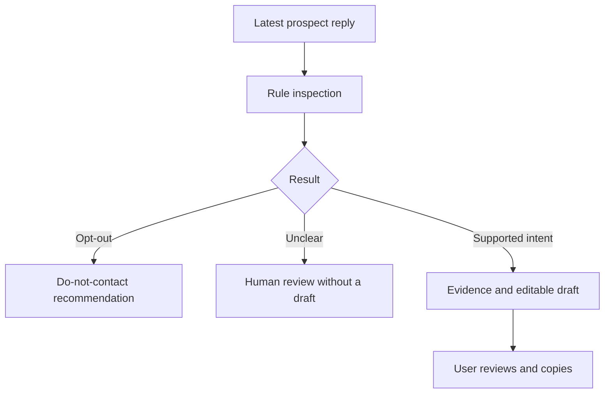

# GTM Lab — sales workflows you can inspect

**Five small open-source tools from a sales and marketing practitioner moving into GTM engineering.**

The flagship is **LinkedIn Reply Desk**: paste a prospect's latest reply, inspect the matched evidence, review the next action and edit a response. The other experiments address campaign diagnosis, call follow-ups, writing quality and campaign links.

Created by **Prity Kar**, with AI-assisted implementation. This is a new prototype portfolio inspired by sales workflows, not a claim that these exact tools were previously deployed for clients. Sample people, organisations, messages and campaign numbers are fictional.

## Try it in under a minute

Open **[index.html](index.html)** in your browser after downloading the repository. It is a self-contained copy of the entire demo. No account, installation or API key is required. GitHub's file viewer shows source; download it to run it.

For local development, install Node.js 20 or newer, open a terminal in this folder, then run:

```sh
npm run demo
```

Visit **http://127.0.0.1:4173**. No `npm install` is needed for the browser demo or tests. To rebuild the standalone demo after editing the source, run `python3 scripts/build_demo.py`.

## The portfolio

| Project | Working behaviour | What it demonstrates |
| --- | --- | --- |
| [LinkedIn Reply Desk](projects/01-linkedin-reply-desk.md) — hero | Six sample replies; paste your own; intent and evidence; editable draft; review gate; JSON export | Human review, cautious classification, clear next actions |
| [Campaign Pulse](projects/02-campaign-pulse.md) | Compare two funnels; count deltas; validation; diagnostic prompts | Funnel maths and careful interpretation |
| [Call → Follow-up](projects/03-call-follow-up.md) | Turn confirmed structured notes into an editable follow-up | Capturing a buyer's stated goal and agreed next step |
| [Outreach Check](projects/04-outreach-check.md) | Flag placeholders, strong promises, long messages and multiple questions | Practical writing checks |
| [Campaign Link Kit](projects/05-campaign-link-kit.md) | Build UTM links while retaining existing query parameters and anchors | Consistent attribution labels |

## What works now, and what is optional

- **Working and locally tested:** all five browser tools, shared JavaScript core, Node tests and the Python-to-Node bridge.
- **Optional integration code:** a Google Agent Development Kit agent that calls the same reply rules and explains the result. It requires Python 3.10+, `google-adk`, Node and your own Gemini API key. The live ADK/model path has **not** been run in the initial build environment; see [setup and limitations](docs/GOOGLE_ADK.md).
- **Not implemented:** LinkedIn API access, scraping, message sending, CRM writes, reminder scheduling, database storage, free-text transcript extraction or a trained ML classifier.

The offline classifier uses regular expressions, not an LLM. Google **ADK is open source**; the optional Gemini API is a separate hosted model service with its own terms and potential costs. This project is not affiliated with or endorsed by Google or LinkedIn.

## How the hero works



No network requests, analytics, remote fonts or browser persistence are used by the demo. A JSON export is a local file and may contain text derived from the reply; handle it accordingly. A do-not-contact recommendation does not actually update your CRM.

## Verification

```sh
npm test
npm run evaluate
```

The initial build passes **20 tests** and **28 synthetic diagnostic examples**. These examples helped develop the rules, so this is **not a held-out benchmark or a claim of real-world accuracy**. Negative availability and contracted declines are explicit regression cases. Some phrasing, sarcasm, quoted threads and non-English language will still be misclassified. Review every result.

## Open-source contribution

Start with [CONTRIBUTING.md](CONTRIBUTING.md), [starter issues](docs/STARTER_ISSUES.md) and the [three-hour sprint plan](docs/DEVFEST_SPRINT.md). Small improvements with fictional examples are welcome. There is no fabricated commit history, client data or adoption metric in this repository.

## Layout

| Path | Purpose |
| --- | --- |
| `src/engine.js` | Pure workflow logic shared by Node and browser |
| `demo/` | Browser interface source |
| `index.html` | Generated standalone demo |
| `agents/reply_desk/` | Optional Google ADK agent and tested rules bridge |
| `tests/` | Regression tests and synthetic diagnostic set |
| `projects/` | Scope and examples for each project |
| `docs/` | Architecture, demo talk track, application kit and sprint plan |

**License:** [MIT](LICENSE). Third-party SDKs and services retain their own licences and terms.
